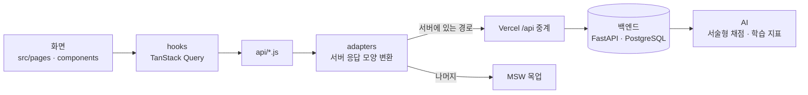

# 피뢰침 — 밀려도 다시 세워 주는 AI 시험 공부 플래너

> 1호선톤 10팀 · 프론트엔드 저장소

강의자료 PDF와 일정을 넣으면 AI가 시험까지의 공부 계획을 짜고, 매일 그날 공부한 범위로 퀴즈를 내고, 계획이 밀리면 남은 일정을 다시 나눠 주는 웹 서비스예요.

<!-- TODO: Vercel 배포 주소가 정해지면 아래 주소를 바꾸세요 -->

|                    |                                                                 |
| ------------------ | --------------------------------------------------------------- |
| **서비스 주소**    | https://pirwichim.vercel.app                                    |
| **백엔드 저장소**  | https://github.com/line1thon-team10/team-10_BE                  |
| **시연 기준 날짜** | 2026년 11월 9일(월) 오후 5시 — 서버가 정한 데모 날짜로 동작해요 |

---

## 핵심 기능

| 기능                       | 내용                                                                                                                                           |
| -------------------------- | ---------------------------------------------------------------------------------------------------------------------------------------------- |
| **계획 만들기**            | 일정 · 목표 대화 → 강의자료 PDF 업로드 → 단원 · 개념 분석 → 시험 범위 확인 → 15~60분 단위 할 일로 나눈 계획                                    |
| **오늘 할 일 · 공부 기록** | 할 일마다 페이지 단위로 기록 (완료 · 부분 완료 · 못 함), 집중 모드로 공부 시간 측정                                                            |
| **오늘의 퀴즈**            | 오늘 목표 70%를 넘기면 열려요. 오늘 공부한 단원 + 어제 틀린 문제, 객관식 · 단답형 · 서술형. **서술형은 AI가 채점**하고 근거 페이지를 보여 줘요 |
| **책 쌓기**                | 단원 이해도를 책 더미로 보여 줘요 (안정 · 흔들림 · 붕괴 위기). 색뿐 아니라 무늬와 글자로도 구분돼서 흑백에서도 읽혀요                          |
| **밀림 회복**              | 하루가 끝나면 밀린 양을 판정해요. 적으면 다음 날로 이월, 많으면 남은 일정을 다시 나눈 분배안 3가지 중 하나를 고르게 해요                       |
| **계획 바꾸기**            | 캘린더(주간 · 월간), 반복 일정 삭제 → 빈 시간 제안, 과목 · 시험일 · 목표 바꾸기 (모두 미리보기 → 적용)                                         |
| **복습 · AI 튜터**         | 누적 오답 노트 · 다시 풀기 · 문제 뽑기, 공부하다 막히면 질문하는 AI 튜터와 '더 쉽게 설명해줘' (튜터는 화면 · 흐름까지, 시연 답변은 준비 중)    |

시연 과목은 AI 파트가 만든 데모 강의자료 3개(인공지능 · 데이터베이스 · 운영체제)예요.

## 심사 · 시연 방법

1. 서비스 주소에 들어가면 로그인 없이 익명 계정이 만들어지고, **11/9 오후 5시 시연 상태**로 홈이 열려요.
2. 헤더의 **데모 ▾** 메뉴로 시연 장면을 바꿀 수 있어요.

| 장면                     | 둘러볼 순서                                                                                                                             |
| ------------------------ | --------------------------------------------------------------------------------------------------------------------------------------- |
| **11/9 오후 5시** (기본) | 홈 → 인공지능 할 일의 집중 모드(42분 진행 중)를 끝내고 기록 → 오늘 70% 달성 → 하루 마무리 박스 → 오늘의 퀴즈 → 결과 · 책 변화 → 책 쌓기 |
| **밀림**                 | 데모 ▾ → 밀림 → 헤더 **[다음 날로]** → 분배안 3가지 → 하나 고르면 회복 박스                                                             |
| **빈 계정**              | 데모 ▾ → 빈 계정 → 일정 · 목표 대화부터 계획 만들기 → 승인하면 11/9 홈으로                                                              |

- 계획 만들기의 PDF 업로드에는 시연용 강의자료를 쓰면 돼요: [인공지능](public/mock/artificial_intelligence.pdf) · [데이터베이스](public/mock/database.pdf) · [운영체제](public/mock/operating_system.pdf) · [실시간 분석용 8쪽](public/mock/realtime_analysis.pdf) · [스캔본 6쪽](public/mock/scanned_document.pdf)
- 스캔본(글자가 이미지로만 된 PDF)은 글자 인식으로 분석하고, 퀴즈 없이 계획에만 넣어요.
- `/dev` 페이지에서 전체 화면 목록과 팝업을 바로 열어 볼 수 있어요.

### 실제 서버 연결 범위

배포본은 **서버에 이미 있는 기능은 실제 백엔드에, 아직 없는 기능은 가짜 서버(목업)에** 연결돼 있어요. 헤더의 **MOCK** 배지는 목업이 섞여 있다는 표시예요.

| 실제 서버 (백엔드 · AI)                           | 목업                                                         |
| ------------------------------------------------- | ------------------------------------------------------------ |
| 익명 계정 · 데모 날짜 · 시연 장면 전환            | 계획 만들기 (일정 대화 · PDF 분석 · 계획 생성 · 다시 나누기) |
| 홈 · 공부 기록 · 하루 마무리 박스 · 이월          | 캘린더 · 빈 시간 제안 · 월간 보기                            |
| 집중 모드 (시작 · 멈춤 · 재개 · 종료)             | 계획 추가 · 과목 · 계획 관리 · 속도 보정 알림                |
| 오늘의 퀴즈 · **AI 서술형 채점** · 결과 · 더 풀기 | 복습 · 오답 노트                                             |
| 책 쌓기 · 단원 점수 · 시험 준비도                 | AI 튜터 (시연 답변 준비 중) · 말로 일정 추가                 |
| 밀림 판정 · 분배안 · 적용                         |                                                              |

## 화면

요구사항 정의서 기준 화면 32개를 모두 만들었어요 (과목 추가 버튼 등 일부 버튼은 준비 중). 자세한 목록과 화면 흐름은 [`docs/screen-ids.md`](docs/screen-ids.md)에 있어요.

| 영역        | 화면                                                                                                                                                                   |
| ----------- | ---------------------------------------------------------------------------------------------------------------------------------------------------------------------- |
| 계획 만들기 | S1 일정 · 목표 대화 · S2 캘린더 확인 · S3 PDF 업로드 · S3-2 목차 직접 입력 · S4 단원 · 범위 확인 · S5 내용 · 분량 확인 · S5-1 다시 나누기 요청 · S5-2 다시 나누기 비교 |
| 홈 · 기록   | S6 홈 · S6-2 조금 밀린 날 · S6-3 AI 튜터 · S6-4 말로 일정 추가 · S7 공부 기록 · S12 집중 모드 · S12-1 공부 끝                                                          |
| 퀴즈 · 책   | S8-1 퀴즈 고르기 · S8 오늘의 퀴즈 · S8-3 서술형 답 입력 · S8-2 퀴즈 결과 · S9 책 쌓기 · S10 복습 · 오답                                                                |
| 계획 바꾸기 | S11 캘린더(주간) · S13 계획 추가 · S14 과목 · 계획 관리 · S15 월간 보기 · S15-1 월간 리포트                                                                            |
| 팝업        | P1 하루 마무리 박스 · P1-1 가벼운 알림 · P2 분배안 · P3 퀴즈 후 책 쌓기 · P4 속도 보정 알림 · P5 빈 시간 제안                                                          |

## 구조



- **화면은 API를 직접 부르지 않아요.** 화면 · 컴포넌트 63개 파일 중 API를 직접 부르는 파일 0개. 주소는 `src/api/endpoints.js` 한 곳, 서버 응답 모양은 `src/api/adapters/`에서만 다뤄요. 그래서 서버 명세가 바뀌어도 화면 코드는 거의 그대로예요.
- **계산은 서버가 해요.** 진행률 · 퀴즈 열림(70%) · 단원 등급 · 시험 준비도 · 밀림 판정은 서버 값을 그대로 보여 줘요.
- **'오늘'은 서버가 정한 데모 날짜예요.** 브라우저 시계를 쓰지 않아서 언제 열어도 같은 장면이 나와요.
- **로그인 없이 익명 ID**로 동작해요. 처음 접속할 때 서버가 발급하고, 요청 헤더(`X-Anonymous-Id`)로 보내요.
- **AI 대기 화면을 하나로 통일했어요.** AI를 기다리는 다섯 곳(계획 생성 · 퀴즈 준비 · 채점 · 튜터 · 분배안)에서 진행 단계 → 8초가 넘으면 안내 → 30초가 넘으면 [다시 시도] · 저장된 결과 순서로 보여 줘요.

## 로컬에서 실행하기

Node.js 20.19 이상 또는 22.12 이상이 필요해요 (권장 22, `.nvmrc`).

```bash
npm install
cp .env.example .env    # Windows CMD: copy .env.example .env
npm run dev             # http://localhost:5173
```

`.env`의 `VITE_USE_MOCK`으로 연결 방식을 고를 수 있어요.

| 값            | 동작                                                                                                 |
| ------------- | ---------------------------------------------------------------------------------------------------- |
| `true` (기본) | 전부 목업. 서버 없이 모든 화면을 볼 수 있어요                                                        |
| `hybrid`      | 서버에 있는 기능만 실제 서버로, 나머지는 목업 (배포본과 같음). `API_PROXY_TARGET`에 백엔드 주소 필요 |
| `false`       | 전부 실제 서버. `API_PROXY_TARGET` 필요                                                              |

개발 서버는 `/api` 요청을 `API_PROXY_TARGET`으로 넘겨서, 백엔드에 CORS 설정이 필요 없어요. 배포본은 Vercel이 같은 일을 해요 (`vercel.json`).

## 품질 관리

- `npm run check` — 린트 → 서식 → 빌드. 커밋 전에 항상 통과시켜요
- **시연 점검 192칸** — 시연 장면 3개 × 주요 화면 16개 × 화면 크기 2개(1280×800 · 1920×1080) × 연결 방식 2개(목업 · 서버 혼합): 가로 스크롤 0건 · 콘솔 JS 오류 0건 ([`docs/qa-checklist.md`](docs/qa-checklist.md))
- **흑백 점검** — 책 상태 6개(예정 · 진행 중 · 완료 · 안정 · 흔들림 · 붕괴 위기)가 흑백에서도 무늬와 글자로 구분돼요
- **오류 게이트** — 한 번 난 문제는 원인 · 금지할 방법 · 대신 할 방법을 [`docs/GATES.md`](docs/GATES.md)에 남겨 같은 실수를 반복하지 않아요
- AI 코딩 도구(Claude Code)로 개발했고, 작업 규칙(확정된 것만 구현 · 모르면 멈추고 묻기 · 가짜 데이터 표시)은 [`CLAUDE.md`](CLAUDE.md)에 있어요

## 기술

React 19 · Vite 7 · React Router 7 · Tailwind CSS 4 · TanStack Query 5 · Zustand 5 · axios · MSW 2 · FullCalendar 6 · react-pdf · Motion 12 · dayjs · sonner · lucide-react · Pretendard · Black Han Sans · IBM Plex Sans KR · Vercel

## 문서

| 문서                                                       | 내용                                                  |
| ---------------------------------------------------------- | ----------------------------------------------------- |
| [`docs/screen-ids.md`](docs/screen-ids.md)                 | 화면 ID · 주소 · 우선순위 · 화면 흐름                 |
| [`docs/api-draft.md`](docs/api-draft.md)                   | API 주소 · 요청 · 응답 · 오류 코드 (백엔드 구현 기준) |
| [`docs/structure.md`](docs/structure.md)                   | 폴더 구조와 파일 역할                                 |
| [`docs/design-decisions.md`](docs/design-decisions.md)     | 디자인 결정 · 토큰                                    |
| [`docs/policy-and-backend.md`](docs/policy-and-backend.md) | 정책 값 · 결정 기록 · 백엔드 / AI 확인 사항           |
| [`docs/qa-checklist.md`](docs/qa-checklist.md)             | 시연 점검 결과                                        |
| [`docs/GATES.md`](docs/GATES.md)                           | 오류 게이트                                           |
| [`docs/handover.md`](docs/handover.md)                     | 인수인계 · 서버 연결 방법                             |
